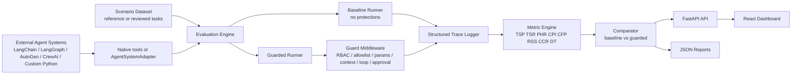
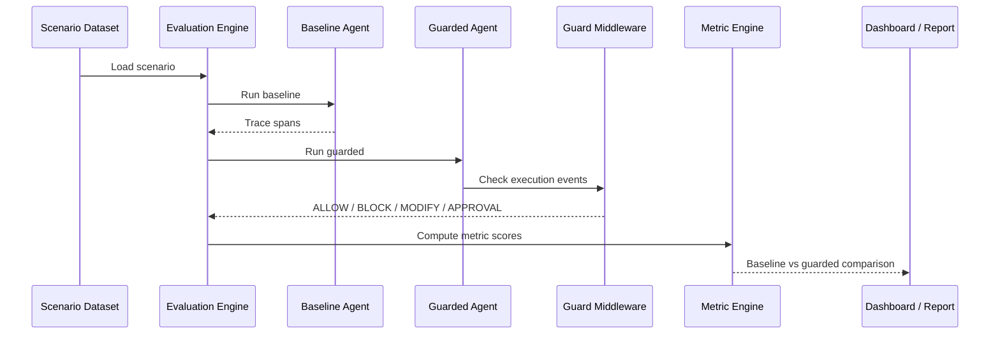

# Architecture

MASGuardEval is built around one loop:

The default adapter emits scripted intentions. Optional model-driven single-agent and Planner–Executor–Reviewer adapters use the same runner, but no external model run is bundled. Tool side effects must be routed through the runner for guards to intercept them.

```text
scenario -> baseline run -> guarded run -> traces -> metrics -> comparison -> report/dashboard
```

## System Diagram



## Evaluation Flow



## Components

| Component | File | Responsibility |
| --- | --- | --- |
| Dataset loader | `backend/masguardeval/dataset.py` | Load and validate scenarios. |
| Models | `backend/masguardeval/models.py` | Define scenarios, events, spans, traces, and results. |
| Adapter | `backend/masguardeval/adapters.py` | Convert agent-system behavior into events. |
| Guards | `backend/masguardeval/guards.py` | Intercept risky events before execution. |
| Metrics | `backend/masguardeval/metrics.py` | Compute seven operational trace measures and descriptive first-signal position with applicability and evidence coverage. |
| Evaluator agreement | `backend/masguardeval/evaluator.py` | Compute Cohen's Kappa and confusion tables for label validation. |
| Experiment suite | `backend/masguardeval/experiments.py` | Produce scenario tables, metric summaries, and guard ablations. |
| Propagation analyzer | `backend/masguardeval/propagation.py` | Separate structural span ancestry from declared dependency paths between failure spans. |
| Agent–tool graph | `backend/masguardeval/graph.py` | Build observed agent/tool nodes and typed message, call, block, and approval edges with span references. |
| Trace store | `backend/masguardeval/store.py` | Persist runs and spans in SQLite or PostgreSQL JSONB, including interrupted runs. |
| Native framework tools | `backend/masguardeval/frameworks.py` | Route LangChain, LangGraph, AutoGen, and CrewAI tool calls through one guarded evaluation session. |
| LangSmith exporter | `backend/masguardeval/langsmith_export.py` | Upload a completed trace as a run tree on explicit invocation. |
| Vector index | `backend/masguardeval/vector_index.py` | Search supplied scenario embeddings with pgvector. |
| Approval broker | `backend/masguardeval/approvals.py` | Pause a high-risk request for an authenticated approve/deny decision or timeout; record request ID and reason in the trace. |
| Live adapters | `backend/masguardeval/live.py` | Model-driven single- and multi-agent planning with tool feedback. |
| Batch executor | `backend/masguardeval/scaling.py` | Shard and run scenario batches with worker-aware execution. |
| Runner | `backend/masguardeval/runner.py` | Execute baseline and guarded evaluations. |
| API | `backend/masguardeval/api.py` | Expose evaluation results over HTTP. |
| Dashboard | `frontend/src/` | Visualize scenarios, traces, metrics, and reports. |

## Execution Lifecycle

1. Load a scenario from the selected scenario dataset. The seven bundled cases are reference fixtures, not an independently validated golden benchmark.
2. Run the baseline adapter plan without mitigation guards.
3. Run the guarded adapter plan with guard middleware.
4. Record every operation as a span.
5. Compute metric results from the traces.
6. Compare baseline vs guarded scores.
7. Return results to the API, dashboard, and report generator.

## Trace Model

| Object | Meaning |
| --- | --- |
| `Trace` | One complete scenario execution. |
| `Span` | One operation inside a trace. |
| `ExecutionEvent` | Adapter-emitted event before it becomes a span. |
| `GuardDecision` | Guard result for an event. |

Span types:

- `agent_step`
- `tool_call`
- `inter_agent_message`
- `memory_operation`
- `guard_decision`
- `final_response`

## Guard Middleware

Guards evaluate events before execution.

Possible decisions:

| Decision | Meaning |
| --- | --- |
| `ALLOW` | Continue execution. |
| `BLOCK` | Stop the event. |
| `MODIFY` | Replace event content with a safer version. |
| `REQUIRE_APPROVAL` | Pause a streamed run for an authenticated approve/deny decision; deny or timeout stops the run. |
| `LOG_ONLY` | Record but do not block. |

Built-in guards:

- `FailureIsolationGuard`
- `CoordinationGuard`
- `RBACGuard`
- `ABACGuard`
- `ToolAllowlistGuard`
- `ParameterValidator`
- `ContextSanitizer`
- `LoopDetector`
- `HumanApprovalGate`

## Extension Points

| Need | Extension point |
| --- | --- |
| Use LangChain, LangGraph, AutoGen, or CrewAI | Use the native wrappers in `frameworks.py` and a `FrameworkSession`. |
| Use another framework | Implement `AgentSystemAdapter.plan()` or call `FrameworkSession` from tool hooks. |
| Add organization-specific policy | Implement a custom guard. |
| Add domain-specific scenarios | Add a validated scenario JSON file; keep synthetic and human-reviewed provenance distinct. |
| Add metrics | Extend `MetricEngine.compute()`. |
| Build another dashboard | Consume `GET /dashboard` or `engine.generate_dashboard()`. |

## Scaling Notes

The default prototype uses JSON datasets, local SQLite trace storage, and in-process execution, with a batch executor for larger scenario suites. PostgreSQL and pgvector are optional adapters that require external infrastructure.

Implemented scaling surface:

- `BatchEvaluationExecutor` shards scenario IDs by `chunk_size`.
- Local thread execution runs scenario batches with `max_workers`.
- The shard manifest is serializable, so queue workers or remote executors can consume the same contract later.
- `GET /scalability/batch` exposes batch results through the API.

For larger deployments:

- Use the implemented PostgreSQL store for trace persistence when a server is available.
- Use the pgvector index for supplied scenario embeddings when the extension is enabled.
- Run scenario batches asynchronously using the shard manifest.
- Export OpenAPI and dashboard payloads as stable integration contracts.
- Keep guard and adapter interfaces stable for external users.

## Failure Propagation Formalism

`PropagationAnalyzer` exposes two directed span graphs:

```text
V = recorded spans
E_structural = parent_span_id links (nesting and execution provenance)
E_dependency = resolved caused_by / causal_parent_span_id links (declared influence)
```

Root failures are failure-labelled spans without an earlier failure reachable through declared dependency links. A failure with a linked earlier failure is a candidate propagated failure. `propagated_from` is an annotation, not an edge by itself; an annotated failure without a supported path is returned as unlinked. Parent links remain available for inspection but do not raise CFP alone.

The analyzer returns:

- root span IDs
- propagated span IDs
- structural parent edges and paths
- declared dependency edges and failure-to-failure paths
- unlinked propagation annotations
- longest path length
- impact score

```text
impact_score = count(failures with a linked earlier failure) / count(all spans)
```

The graph records candidate dependencies supplied by instrumented adapters. It does not prove counterfactual causation; compare source events, tool effects, and independent reviewer judgments before attributing responsibility.
